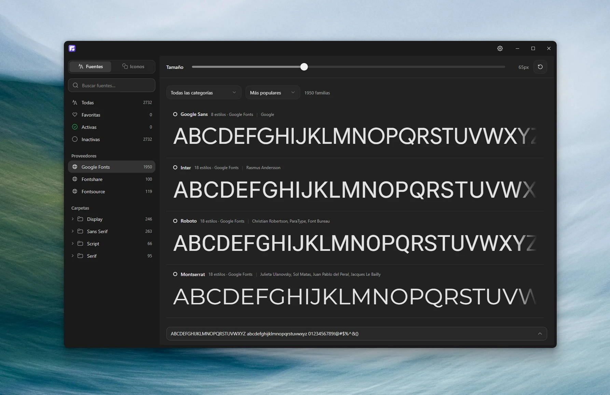

<p align="center">
  
</p>

<h1 align="center">FontVault</h1>

<p align="center">Gestor de fuentes e iconos para diseñadores, para Windows.</p>



## Qué hace

- **Fuentes locales:** lee tus carpetas (con subcarpetas) y activa las fuentes en Windows sin instalarlas.
- **Proveedores:** Google Fonts, Fontshare y Fontsource, con vista previa y activación con un clic.
- **Detalle de cada familia:** estilos, cascada de tamaños, glifos y metadatos (licencia, diseñador, funciones OpenType).
- **Iconos:** más de 200 colecciones de Iconify, búsqueda en español e inglés, bibliotecas sin conexión y arrastrar a Figma, Illustrator o cualquier app que acepte SVG.
- Favoritos, tema claro y oscuro, y efectos de sonido.

## Instalación

Descarga el instalador de la [última versión](https://github.com/jdsgnrinfo/fontvault/releases/latest) y ábrelo.

## Desarrollo

```bash
npm install
npm start        # compila la interfaz y abre la app
npm test         # pruebas
npm run dist     # genera el instalador en release/
```
